<p align="center"></p>

<p align="center">
  <picture>
    <source media="(prefers-color-scheme: dark)" srcset="https://readme-typing-svg.demolab.com?font=JetBrains+Mono&weight=500&size=16&pause=1800&color=2EC4B6&center=true&vCenter=true&width=520&height=30&lines=%3E+Hello%2C+I'm+Kevin_;%3E+Software+Engineer+%C2%B7+Jakarta%2C+Indonesia;%3E+Web+%C2%B7+Backend+%C2%B7+Mobile+%C2%B7+Applied+AI" />
    
  </picture>
</p>

<p align="center">
  <a href="https://kevinaprilio-portfolio.vercel.app/"></a>
  <a href="https://linkedin.com/in/alessandro-kevin-aprilio"></a>
  <a href="mailto:kevinaprilio1406@gmail.com"></a>
  <a href="https://instagram.com/epinnn14"></a>
</p>

<p align="center"><sub><i>Building things that actually ship.</i></sub></p>

<p align="center"></p>

### About

<picture>
  <source media="(prefers-color-scheme: dark)" srcset="https://raw.githubusercontent.com/Epinnn14/Epinnn14/HEAD/profile/about.svg" />
  
</picture>

```console
$ whoami
kevin — software engineer, jakarta

$ cat now.txt
→ App Developer Intern @ BINUS
→ AI Engineering @ FlyRank AI (done)
→ Software Engineering, final year

$ echo $FOCUS
Python · FastAPI · Flutter · ML

$ ./contact --open-to
internships · freelance · side projects
```

### Stack

<p>
  <br/>
  <br/>
  <br/>
  
</p>

### Activity

> Languages across my repos. Refreshed every day.

<p align="center">
  <picture>
    <source media="(prefers-color-scheme: dark)" srcset="https://raw.githubusercontent.com/Epinnn14/Epinnn14/HEAD/profile/top-langs.svg" />
    
  </picture>
</p>

### Certifications

| Issuer | Program |
| :-- | :-- |
| **Columbia+** | AI Cybersecurity and Governance — Columbia Engineering Executive Education |
| **FlyRank AI** | Backend AI Engineering · Front-end AI Engineering · AI Fluency · Machine Learning |
| **Dicoding × DBS Foundation** | Coding Camp 2026 — AI Engineer path |
| **Anthropic** | Claude API · Claude Code · Model Context Protocol |
| **Dicoding** | Deep Learning · AWS Cloud Practitioner · Microsoft Fabric & more |
| **BINUS University** | Advanced English (C2) |

<p align="center">
  <sub>Jakarta, Indonesia &nbsp;·&nbsp; <a href="https://kevinaprilio-portfolio.vercel.app/">kevinaprilio-portfolio.vercel.app</a></sub>
</p>

<p align="center"></p>
